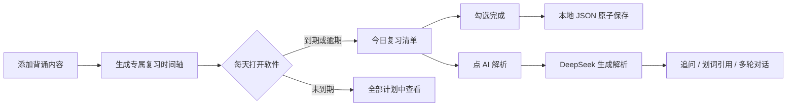
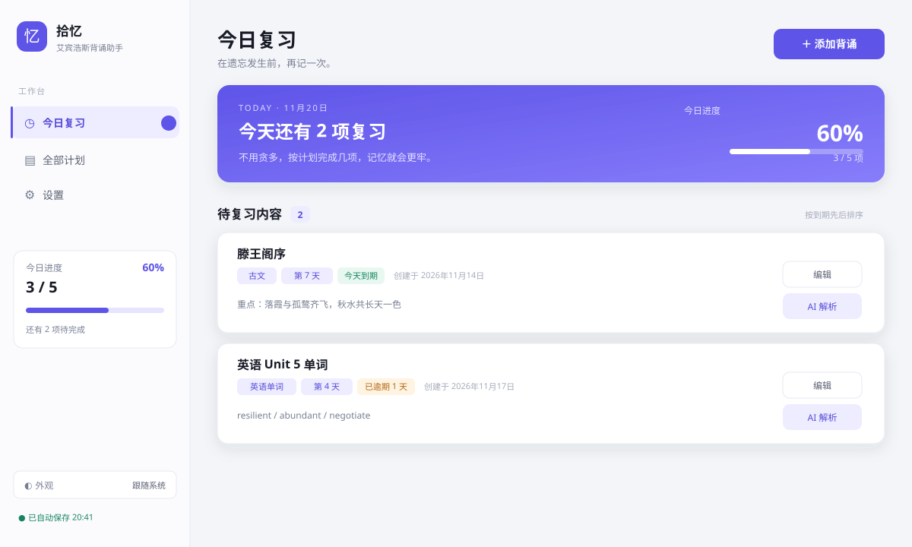
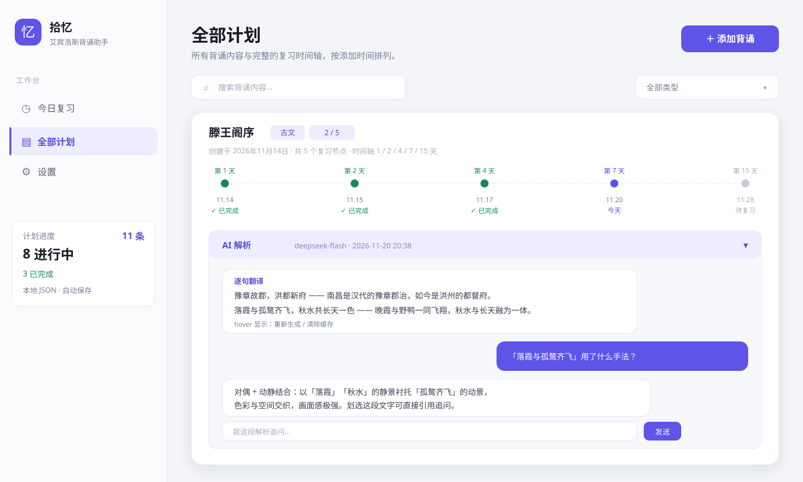

<div align="center">


# 拾忆 · 艾宾浩斯背诵助手

**把遗忘曲线装进桌面：自动生成复习计划，让 AI 讲透每一个知识点。**


[快速开始](#快速开始) · [功能亮点](#功能亮点) · [AI 解析](#ai-解析与追问) · [界面预览](#界面预览) · [常见问题](#常见问题)

</div>

---

## 为什么是拾忆

背了就忘，不是记忆力差，而是复习时机不对。艾宾浩斯遗忘曲线告诉我们：新学的内容在 **第 1、2、4、7、15 天**  revisit 一次，记忆保留率会显著提升。

但手工排期太麻烦——今天该复习哪几篇？昨天漏掉的节点怎么办？古诗文里那个字词到底什么意思？

拾忆把这三件事一次做完：

1. **自动排期**：添加内容即生成专属复习时间轴（可增删改节点）。
2. **每日提醒**：打开软件就是今天该复习的清单，逾期节点自动顺延显示。
3. **AI 讲透**：DeepSeek 按内容类型生成解析，还能继续追问、划词引用、多轮对话。

全程本地运行，数据只存在你自己的电脑里。

## 功能亮点

| | 能力 | 说明 |
| --- | --- | --- |
| 01 | **科学复习节奏** | 默认第 1 / 2 / 4 / 7 / 15 天，每条内容可单独调整，最多 10 个节点（最长 3650 天） |
| 02 | **逾期不丢失** | 没打开软件的日子不会跳过，漏掉的节点以「已逾期 N 天」继续出现在今日待办 |
| 03 | **完全自定义类型** | 诗词 / 古文 / 英语单词开箱即用，可自由增删改名，每种类型配一套 AI 解析提示词 |
| 04 | **DeepSeek AI 解析** | 深度思考、服务端联网搜索、思考强度、采样参数全部可调；英语单词自动拆词根词缀 + 同源词 |
| 05 | **会对话的解析** | 解析面板就是聊天窗：追问、编辑、重新生成、删除单条消息，划选文字即可引用追问 |
| 06 | **即时筛选搜索** | 「全部计划」按标题 / 备注 / 类型实时搜索，可与类型筛选叠加 |
| 07 | **三种外观** | 浅色 / 深色 / 跟随系统，自动适配 Windows 主题 |
| 08 | **本地 + 原子保存** | 数据写在同目录 `review_data.json`，临时文件 + 整体替换，损坏自动备份 |
| 09 | **开箱即用** | 一键 `.bat` 启动，一键打包单文件 exe，不需要管理员权限 |

## 它如何工作



## 界面预览

<table>
  <tr>
    <td align="center"><b>今日复习：一眼看清该背什么</b><br/></td>
    <td align="center"><b>AI 解析：可追问、可引用的对话窗</b><br/></td>
  </tr>
</table>

## 快速开始

### 方式一：下载 exe（适合大多数用户）

双击 `dist\拾忆背诵助手.exe`，或从桌面快捷方式 **「拾忆背诵助手」** 启动。首次运行会在 exe 同目录生成 `review_data.json`。

> exe 依赖 **Microsoft Edge WebView2 Runtime**（Windows 10/11 通常已预装）。请放在桌面、文档等普通目录，**不要放在 `Program Files` 等需要管理员权限的位置**——单文件 exe 需要解压到当前目录。

### 方式二：源码启动

```bat
:: 双击 启动工具.bat，或手动执行：
python -m pip install -r requirements.txt
python webview_app.py
```

环境要求：**Windows 10/11 64 位 + Python 3.10+** + WebView2 Runtime。依赖检查与安装由 `启动工具.bat` 自动完成。

调试模式（打开 WebView2 开发者工具）：

```bat
python webview_app.py --debug
```

### 方式三：自己打包 exe

双击 **`打包exe.bat`**，脚本会自动安装依赖、清理缓存、PyInstaller 单文件打包，并创建/修复桌面快捷方式。产物在 `dist\拾忆背诵助手.exe`。

## 怎么用

### 1. 添加一条背诵

点击右上角 **「＋ 添加背诵」** → 填标题和备注 → 选类型 → 确认时间轴 → 点「添加并生成计划」。

时间轴输入框下方会实时显示对应的复习日期：

- `1` = 添加当天，`2` = 次日；
- 点 **「＋ 增加节点」** 按遗忘曲线自动补下一个值（默认 5 个之后是 `30 / 60 / 120 …`）；
- 点 **「－ 删除节点」** 去掉最后一个，至少保留 1 个；
- 节点必须是递增正整数，最多 10 个。

### 2. 每天打开就复习

「今日复习」是首页，只显示**今天及逾期未完成**的任务。勾选「完成」立即保存并从待办移除；同一条内容有多个到期节点时会分别列出。

快捷键：`Ctrl + N` 快速添加 · `Esc` 关闭弹窗 · `F5` 跨天刷新今日任务。

### 3. 随时调整

- **改内容**：「全部计划」卡片上点「编辑」，标题、备注、类型都能改；复习进度与时间轴不受影响。
- **改时间轴**：卡片上点「时间轴」，以最初添加日期为基准重算；仍保留的节点会继承完成状态。
- **删除**：二次确认后才会删，误删风险低。

## AI 解析与追问

在左侧 **「设置」** 里填入 DeepSeek API Key（[申请地址](https://platform.deepseek.com/)），即可在任意背诵卡片上点 **「AI 解析」**。

> API Key 与全部背诵内容一起保存在本地 `review_data.json`。**不要把这个文件分享给别人**，提交到 Git 前请确认它已被 `.gitignore` 忽略。

**解析面板 = 对话窗口：**

- 底部输入框继续追问，`Enter` 发送、`Shift + Enter` 换行；
- 划选 AI 回复中的文字，浮出「追问」按钮，引用会带进输入框；
- 鼠标移到消息上，AI 消息可「重新生成 / 清除缓存」，自己的消息可「编辑 / 删除」；
- 编辑后发送：该条之后的对话清除并按新内容重来；删除：只删这条和紧跟的 AI 回复，其余保留；
- 所有对话随解析一起本地缓存，今日复习和全部计划共用同一份，无需重复调用接口。

**可按类型定制提示词**：默认「诗词 / 古文 / 英语单词」各有一套模板，在设置里可改、可增删类型。类型提示词**只在首次生成解析时生效**，后续追问统一使用「系统提示词」。

### 可配置项

| 项目 | 说明 |
| --- | --- |
| API Key / API 地址 | 默认 `https://api.deepseek.com` |
| 模型 | 默认 `deepseek-flash`（V4.1 Flash），可填其他兼容模型 |
| 深度思考 | `thinking.type=enabled`，思考强度 low / high / max |
| 联网搜索 | 开启 `deepseek_web_search`，思考模式下可多步联网 |
| temperature / top_p | 非思考模式下生效；思考或联网开启时服务端会忽略 |
| max_tokens | 256 ~ 32768 |
| 系统提示词 | 首次解析与所有追问共用的角色设定 |
| 添加后自动生成 | 默认关闭，避免每次添加都产生费用 |

「测试连接」会先保存当前设置，再用一次 64 token 的极简请求验证 Key 与网络。每次生成、追问、重新生成都会调用接口，按 DeepSeek 官方价格计费。

## 复习规则

数据里的「第 N 天」表示**距添加当天的第 N 天**。例如 **10 月 25 日** 添加、默认时间轴：

| 节点 | 日期 |
| --- | --- |
| 第 1 天 | 10 月 25 日（添加当天） |
| 第 2 天 | 10 月 26 日 |
| 第 4 天 | 10 月 28 日 |
| 第 7 天 | 10 月 31 日 |
| 第 15 天 | 11 月 8 日 |

每条内容有自己的 `interval_days`，互不影响。漏掉的节点不会消失，会以「已逾期 N 天」继续出现，补做后勾选即可。

## 数据安全

- 所有数据保存在程序同目录的 `review_data.json`，**不联网上传**（AI 解析除外，仅发送你主动生成的内容）。
- 保存采用「临时文件 + 原子替换」，避免写坏原文件；JSON 被改坏时自动备份为 `review_data.corrupt-时间戳.json` 并以空数据启动。
- 建议定期手动备份该文件；分享或提交前请删除 `settings.ai.apiKey`。
- 仓库的 `.gitignore` 已排除 `review_data.json`、`dist/`、`.env` 等敏感与构建文件。

## 项目结构

```text
拾忆背诵工具/
├─ webview_app.py          # WebView2 桌面外壳 + 暴露给前端的 JS API
├─ core.py                 # 纯业务后端：日期计算、JSON 读写、增删改、AI 设置
├─ ai_client.py            # DeepSeek Chat Completions 请求封装与中文错误提示
├─ app.py                  # 旧版 customtkinter 界面（保留作对照）
├─ web/                    # WebView2 前端
│  ├─ index.html           # 页面骨架
│  ├─ styles.css           # 浅色 / 深色主题
│  └─ app.js               # 渲染、弹窗、对话与交互
├─ assets/                 # 程序图标（ico / png）
├─ docs/screenshots/       # README 界面示意图
├─ review_data.json        # 本地数据（运行后生成，已忽略）
├─ requirements.txt        # 依赖清单
├─ 启动工具.bat            # 一键启动
├─ 打包exe.bat             # 一键打包
└─ .gitignore
```

架构上界面与业务彻底解耦：改视觉只动 `web/`，改规则只动 `core.py`，换 AI 供应商只动 `ai_client.py`。

## 常见问题

**双击后没反应？**
在命令行运行 `python webview_app.py`，终端会显示具体报错。

**提示无法启动 WebView2？**
确认系统为 64 位 Windows 10/11，并安装 [WebView2 Runtime](https://developer.microsoft.com/microsoft-edge/webview2/)。

**exe 报 `Could not create temporary directory`？**
把程序移到桌面、文档等普通用户可写的目录，不要用管理员权限安装到 `Program Files`。

**AI 报 401 / 余额不足 / 网络失败？**
设置里点「测试连接」查看具体原因；界面会把 SDK 错误翻译成中文提示。

**打包失败？**
先关闭正在运行的 `拾忆背诵助手.exe`，再重新执行 `打包exe.bat`（运行中的实例会占用解压目录）。

## 技术栈

Python 3.10+ · pywebview（Edge WebView2）· 原生 HTML / CSS / JavaScript · OpenAI SDK（DeepSeek 兼容接口）· PyInstaller · 本地 JSON 存储

## 许可

[MIT License](LICENSE) —— 可自由使用、修改和分享，欢迎 Star 与反馈。

---

<div align="center">愿每一次按时回顾，都让记忆多留一会儿。</div>
